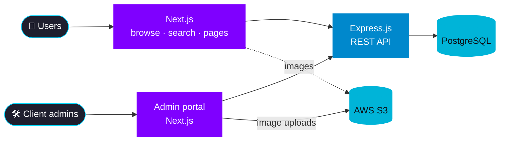
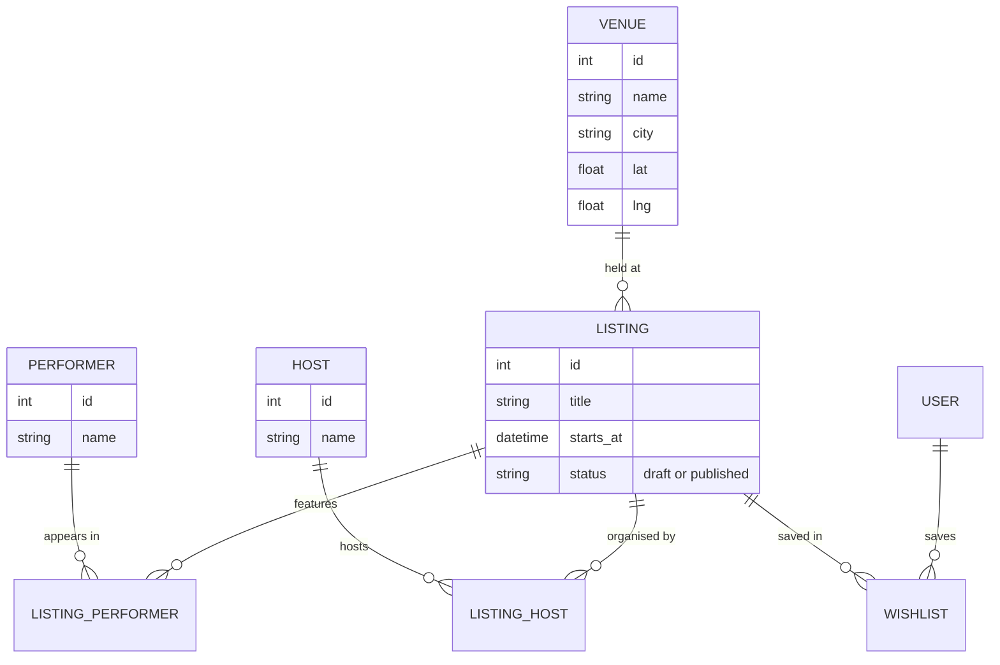

  

  
  
  

  

> **TL;DR** — I built a paid event discovery platform end to end, solo: the data model, the API, an admin portal for the client's team, and a Netflix-style browsing experience for users with city filters, full-text search and wishlists.
>
> Client project: the code is private and the client isn't named here.

---

## 🎯 The problem

The client wanted one place where people can **find events in their city** and follow the **artists and organisers** they like — and a way for their own team to **publish and manage listings** without touching code.

That meant two very different products on one data model:

| Users want | The client's team wants |
|---|---|
| Browse fast, filter by city, search | Create and edit events easily |
| See an artist's past and upcoming shows | Link events to performers, hosts, venues |
| Save events for later | Prepare listings before they go live |

---

## 🏗️ Architecture

<!-- Confirm: do uploads go straight from the admin portal to S3 (e.g. pre-signed URLs, as drawn) or through the Express API? -->

---

## 🧩 Data model

The core of the project. An event can have **many performers** and **many hosts**, and a performer or host appears in **many events** — classic **many-to-many**, modelled with join tables. Venues are **geocoded** so events can be filtered by location.

<!-- Simplified for illustration — rename tables/columns to match your real schema. -->

**Why it's shaped this way**
- **Join tables** instead of arrays or copies: an artist's page is one query over `LISTING_PERFORMER`, and renaming an artist updates everywhere at once.
- **Geocoded venues** (lat/lng + city) make city filters cheap and leave room for "near me" later.
- **A status column for drafts**: the client's team can prepare a listing fully, then publish it, without half-finished events going live.

---

## 🔧 What I built

### For users
- **Netflix-style browsing** — rows of events to scroll through, built to feel fast.
- **City filters** and **full-text search** across listings.
- **Wishlists** to save events.
- **Dynamic artist and organiser pages** that pull together **past shows, upcoming dates and galleries** — generated from the data, not written by hand.

### For the client's team
- An **admin portal** for full event **CRUD**.
- **AWS S3 image uploads** for posters and galleries.
- **Entity linking** — attach performers, hosts and a venue to an event from the editor.
- **Draft states** so listings go live only when ready.

---

## 🧠 What this project taught me

- **Owning everything end to end** — schema, API, two front ends, deployment, and talking to the client — with no one else to hand a piece to.
- **The data model is the product.** Getting the many-to-many relations right early made every later feature (artist pages, filters, wishlists) a query instead of a rewrite.
- **Admin UX matters as much as user UX** — if publishing is painful, the site goes stale.

---

## 🔁 What I'd do differently

<!-- Suggestions — edit to make them your own. -->

- **Add search ranking signals** (date proximity, popularity) on top of plain full-text match.
- **Cache the browse rows** — they're read far more than they change.
- **Write integration tests around the admin flows** early, since a broken editor blocks the client's whole team.

---

  Want to go deeper on any of these? Reach me at <a href="mailto:vishwajeet.natu@iitb.ac.in">vishwajeet.natu@iitb.ac.in</a> · <a href="./README.md">← All case studies</a>

