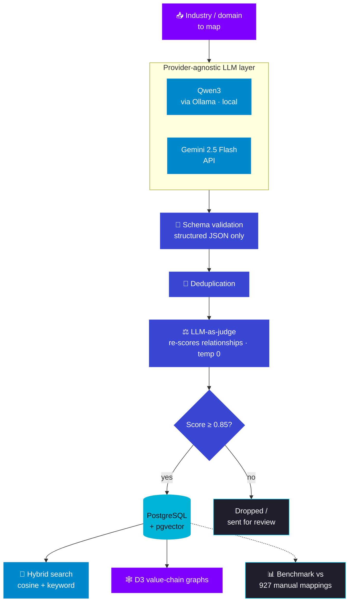

  

  
  

  
  
  
  

  
  
  
  
  

> **TL;DR:** I built an AI-assisted industry intelligence platform: LLM pipelines that generate industry taxonomies and relationships, guardrails that make the output trustworthy, a hybrid search over the results, and value-chain graphs to explore them. I measured quality against **927 manually mapped industries**.
>
> This was client work: no proprietary code, prompts or data are shared here.

---

## 🎯 The problem

Research teams need to understand **how industries break down and connect**: sub-segments, suppliers, customers, value chains. Mapping this by hand is slow and doesn't scale across many domains.

LLMs can draft these maps quickly, but raw LLM output has three problems:

1. **It's unstructured.** Free text can't go straight into a database.
2. **It's unreliable.** Duplicates, made-up links and confident nonsense.
3. **It's hard to judge.** Without a baseline, "looks right" is the only check.

So the real job wasn't "call an LLM". It was **build a pipeline whose output a team can trust and search**.

---

## 🏗️ Pipeline

<!-- Confirm the order: does the 0.85 gate apply to the judge's score (as drawn) or to the generation score before the judge? Also confirm what happens to rejected items. -->

---

## 🔧 What I built

### 1. A provider-agnostic LLM layer
One interface, two back ends: **Qwen3 running locally on Ollama** and **Gemini 2.5 Flash over the API**. Switching is a **config change**, not a code change.

**Why it matters:** local and API models trade off differently:

| | Local (Qwen3 / Ollama) | API (Gemini 2.5 Flash) |
|---|---|---|
| Cost | No per-call cost | Pay per call |
| Privacy | Data never leaves the machine | Data goes to a provider |
| Speed / quality | Bound by local hardware | Fast, strong model |

Keeping the choice in config meant we could pick per task, and the rest of the pipeline never cared which model ran.

### 2. Guardrails: structure, dedup, confidence
- **Structured JSON output** checked against a **schema**. Anything malformed is rejected, not "fixed up".
- **Deduplication** so the same entity or link doesn't show up twice under slightly different names.
- **0.85 score gating**: only relationships scored above the threshold are kept.

**The 0.85 threshold is a precision/recall trade-off.** Raise it and you keep fewer, more reliable links (higher precision, lower recall); lower it and you keep more, with more noise. The benchmark below is how you choose the number with data instead of gut feel.

### 3. LLM-as-judge at temperature 0
A second pass where an LLM **re-scores each relationship against a schema**, at **temperature 0** so the same input gives the same verdict. The judge has to be repeatable to be useful.

### 4. Benchmarking against 927 manual mappings
**927 industries** had been mapped by hand. I compared the AI output against them to **quantify mapping precision**, turning "the output looks good" into a number we could track as prompts, models and thresholds changed.

### 5. Generated 22 domain taxonomies
The pipeline above produced **22 domain taxonomies**.

### 6. Hybrid semantic search
Search over the stored entities blends **pgvector cosine similarity** (meaning) with **keyword text matching** (exact terms).

**Why both:** vector search finds "electric vehicle batteries" when you type "EV cells", but can miss exact names and codes; keyword search is the reverse. Blending them covers both.

### 7. Value-chain visualisation
Visualised value chains as **2 multi-level D3.js graphs** with **zoom, pan and switchable variants**, so researchers can explore how an industry connects instead of reading a table.

---

## 🔁 What I'd do differently

<!-- Suggestions. Edit to make them your own. -->

- **Track precision and recall per domain**, not just overall, since some domains are much harder than others, and a single threshold may not fit all.
- **Cache LLM responses** keyed by input and model, so re-running the pipeline after a small change doesn't re-pay for every call.
- **Add a small human-review loop** for items just under the threshold, and feed those decisions back into the benchmark set.

---

  Want to go deeper on any of these? Reach me at <a href="mailto:vishwajeet.natu@iitb.ac.in">vishwajeet.natu@iitb.ac.in</a> · <a href="./README.md">← All case studies</a>

