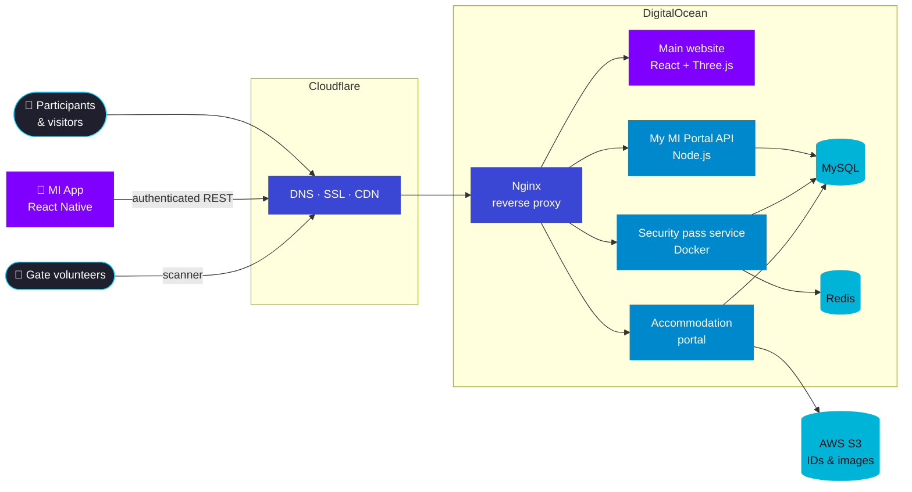
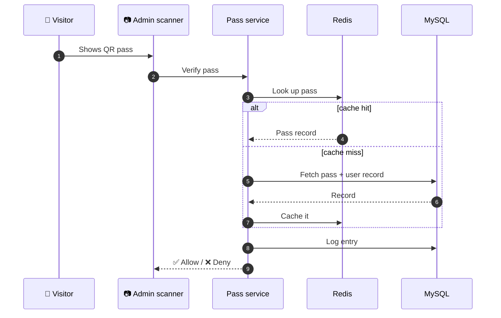
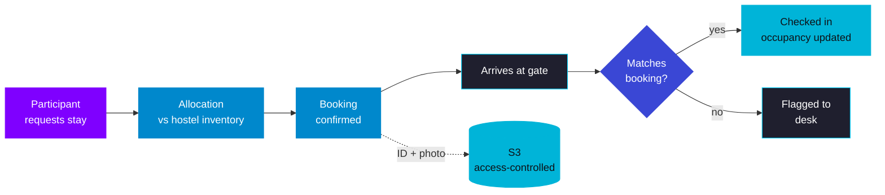

  

  
  
  

  
  
  
  
  

> **TL;DR:** I ran the tech for Asia's largest college cultural festival: a registration platform that took **165K+ sign-ups**, a 3D website that served **20M+ hits**, QR gate security, hostel allocation for **7K+ participants**, a mobile app, and the production infrastructure under all of it, with a **300+ volunteer** team.
>
> The code lives in private Mood Indigo repositories. Live: [moodindigo.in](https://moodindigo.in) · [my.moodindigo.in](https://my.moodindigo.in)

---

## 📌 Contents

1. [The problem](#-the-problem)
2. [System overview](#-system-overview)
3. [My MI Portal: 165K+ registrations](#1-my-mi-portal-165k-registrations)
4. [Main website: 20M+ hits](#2-main-website-20m-hits)
5. [Security pass system: QR gate entry](#3-security-pass-system-qr-gate-entry)
6. [Accommodation portal: 7K+ participants](#4-accommodation-portal-7k-participants)
7. [Mood Indigo app](#5-mood-indigo-app)
8. [Infrastructure and running live events](#6-infrastructure-and-running-live-events)
9. [Growth and automation](#7-growth-and-automation)
10. [What I'd do differently](#-what-id-do-differently)

---

## 🎯 The problem

Mood Indigo is IIT Bombay's annual cultural festival with **163K+ footfall, 9K+ colleges, 240+ events**. Almost every part of the festival touches software:

- Participants from thousands of colleges **register online** months in advance, and traffic spikes hard around announcements and deadlines.
- The **main website** is the festival's public face and gets hammered during launches.
- On the festival days, **every person entering campus** must be verified at the gate quickly, or queues build up.
- Thousands of outstation participants need **hostel rooms**, allocated fairly and checked in on arrival.
- All of this runs on a student team, on a student budget, with a hard deadline that does not move.

My job as Web & Tech Head was to own this whole surface: **25+ pages, 5+ portals and the mobile app**, and the people building them.

---

## 🗺️ System overview

<!-- Confirm before publishing: which services share the MySQL database, and whether the main site is served from the same Nginx host. Adjust the diagram if not. -->

---

## 1. My MI Portal: 165K+ registrations

`Node.js` `MySQL` `Session auth` · *Jun '25 - Oct '25*

**What it is.** The participant-facing platform: one system behind **7+ portals**, each with its own design and animations (registrations, competitions, passes and more), so participants get one account across the whole festival.

**What I built**
- A **multi-tenant** design: one backend and one user model, with each portal as a tenant that has its own UI. A new portal means a new front end, not a new backend.
- A **Node.js + MySQL** backend that absorbed **165K+ registrations** through peak load.
- **Personalised dashboards** served over **indexed queries**, with **session-based access control** so each role (participant, coordinator, admin) sees only what it should.

**Key decisions**

| Decision | Why |
|---|---|
| One shared backend for 7+ portals | Avoids 7 copies of auth, user data and bugs; one place to scale and secure |
| Indexes shaped around dashboard reads | Dashboard reads dominate traffic; indexing the lookup columns keeps them fast as the table grows past 100K+ rows |
| Session-based access per role | Simple to reason about, easy to revoke, fits a server-rendered + API mix |

---

## 2. Main website: 20M+ hits

`React.js` `Three.js` `JS animations` · *Nov '25 - Dec '25*

**What it is.** The festival's public 3D website and the first thing anyone sees.

**What I did**
- Led **8+ developers** to ship it, and owned **code review and merges** so the site stayed consistent.
- Pushed **mobile-first** layouts and tuned the custom **JS-driven animations** so the 3D scenes hold smooth frame rates on phones, where most visitors are.
- The site **sustained 20M+ hits** at peak with consistent rendering across devices, screen sizes and browsers.
- Owned **SEO and caching** across all public-facing festival sites.

**The hard part.** 3D on the web looks great on a laptop and stutters on a mid-range phone. The work was deciding what to cut, simplify or defer on smaller screens, without the site feeling like a lesser version.

---

## 3. Security pass system: QR gate entry

`Docker` `Redis` `QR` · *Nov '25 - Dec '25*

**The problem.** On festival days, every visitor must be verified at the gate. Manual checks against lists are slow, and slow gates mean long queues and crowd risk.

**What I built**
- A **QR-based entry system** that captures visitor records and issues **verified campus passes**.
- An **admin scanner** for gate volunteers that resolves a pass to its **user record** and **logs every entry**.
- Services **containerised with Docker**, with **hot lookups cached in Redis** for **sub-second** checks at the gate.

**Result.** Eased crowd flow and cut **manual gate effort by 40%**.

<!-- Confirm the cache flow matches what you built (cache-aside as drawn). -->

---

## 4. Accommodation portal: 7K+ participants

`Node.js` `AWS S3` `QR check-in` · *Dec '25*

**The problem.** Thousands of outstation participants need rooms across campus hostels. Done by hand with spreadsheets and calls, it's slow, error-prone and hard to track live.

**What I built**
- **Automated room assignment** for **7K+ participants** against hostel inventory and **live occupancy**.
- **Gate verification wired into check-in**: every guest is validated against their booking on arrival.
- Entry images and ID documents stored in **AWS S3 behind access-controlled retrieval**, so sensitive documents are never public.

**Result.** Cut **40+ man-hours** of manual coordination.

---

## 5. Mood Indigo app

`React Native` `Android` `iOS` · *Oct '25 - Dec '25*

- Launched the official app on **Android and iOS** with secure login and registration.
- A **4-tab** interface: **event info, passes, venue maps** and personalised profiles.
- **Ticketing and attendee state** synced against the shared festival backend over **authenticated REST**, using the same accounts as the web portal.

---

## 6. Infrastructure and running live events

`DigitalOcean` `Nginx` `Cloudflare`

- Ran production on **DigitalOcean** behind **Nginx**, with **DNS, SSL and CDN** through **Cloudflare**.
- Held services up through **peak traffic** and **triaged incidents during live events**. When something breaks during the festival, there's no "fix it next sprint".
- Led a **2-tier team of 300+ volunteers** across the festival's tech delivery.

---

## 7. Growth and automation

- **Certificate portal**: automated issuance of **20K+ certificates**, cutting that workload by **30%**.
- **Indigo Squad**: grew the festival's ambassador community to **165K+ members** through **rank-based referral loops** instead of paid ads.

---

## 🔁 What I'd do differently

<!-- These are suggestions. Edit them so they're your own honest take. Interviewers often ask this. -->

- **Load-test before launch, not during it.** Run scripted load tests (e.g. k6) against registration and gate verification before each spike, instead of learning the limits live.
- **Add observability earlier.** Central logs, request metrics and alerts from day one would have made live-event triage faster.
- **Put heavy jobs in a queue.** Things like certificate generation fit a background queue better than request-time work.

---

  Want to go deeper on any of these? Reach me at <a href="mailto:vishwajeet.natu@iitb.ac.in">vishwajeet.natu@iitb.ac.in</a> · <a href="./README.md">← All case studies</a>

